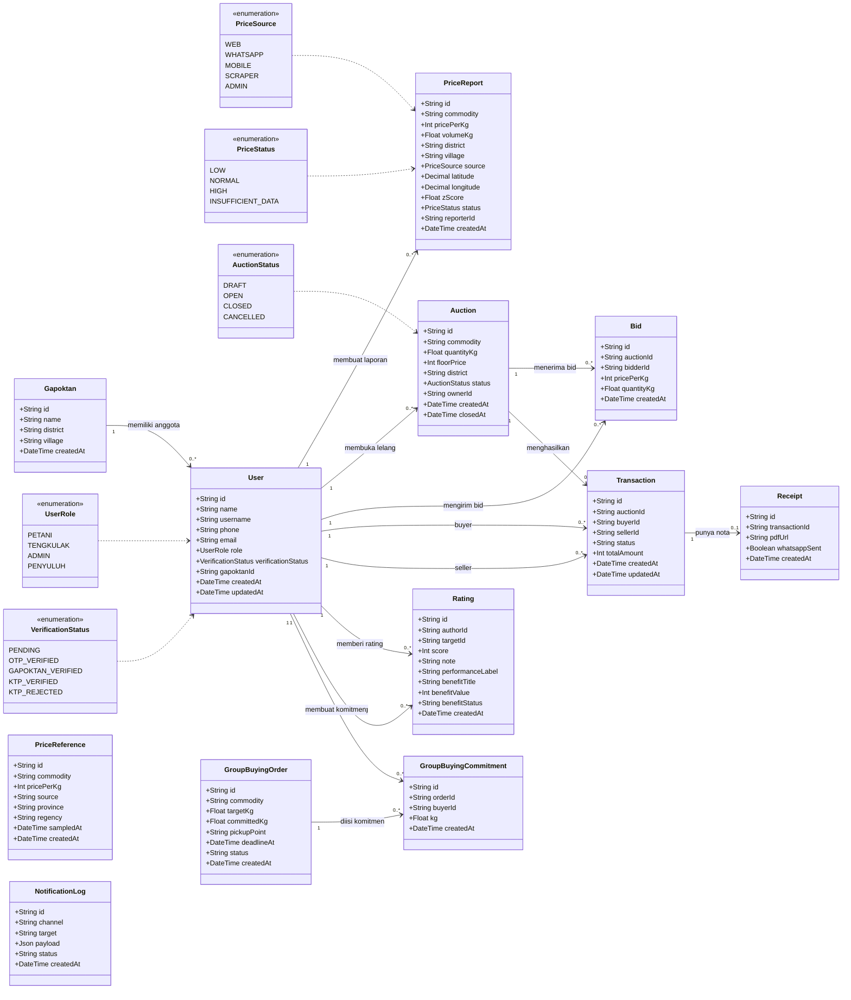
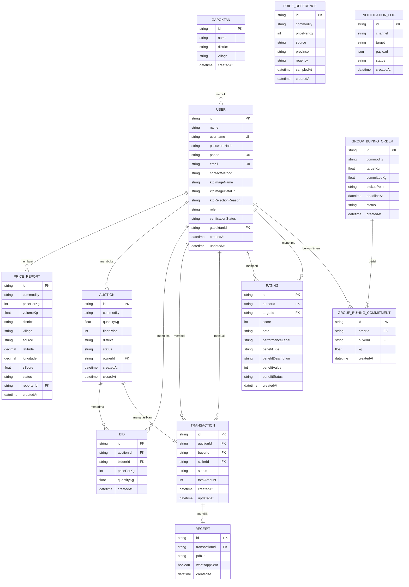
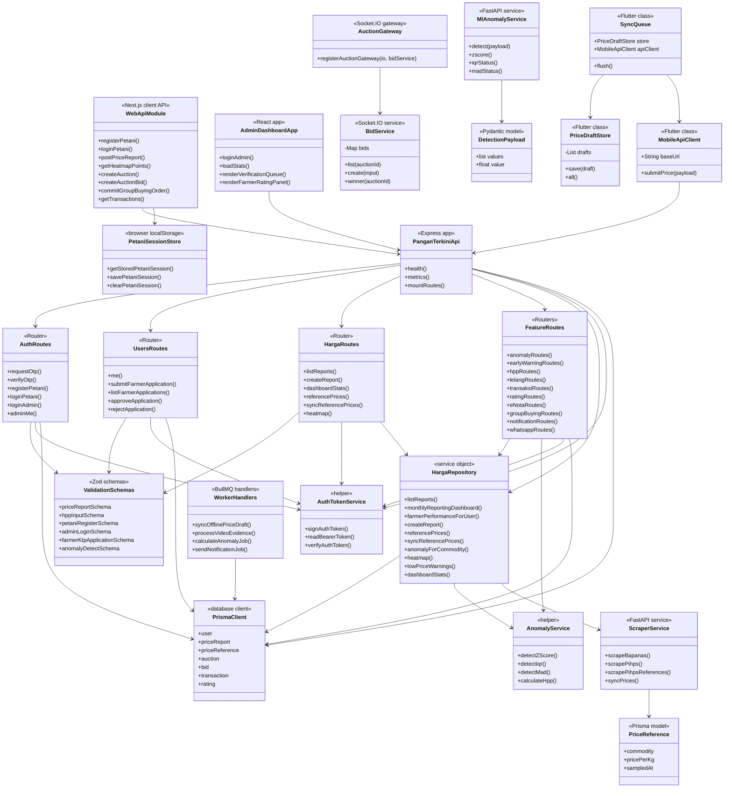
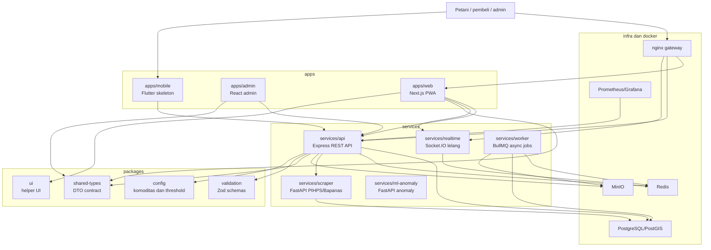
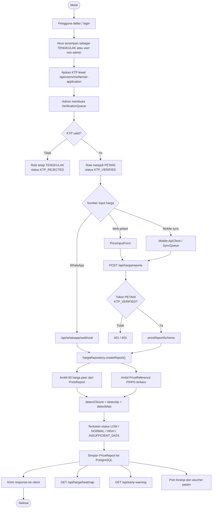
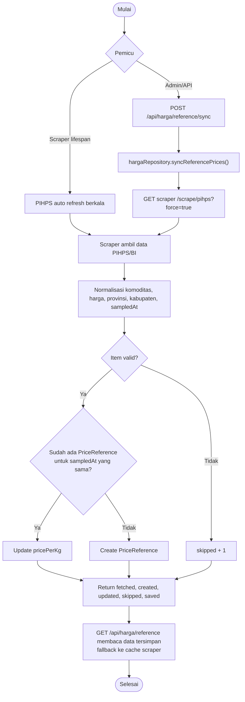
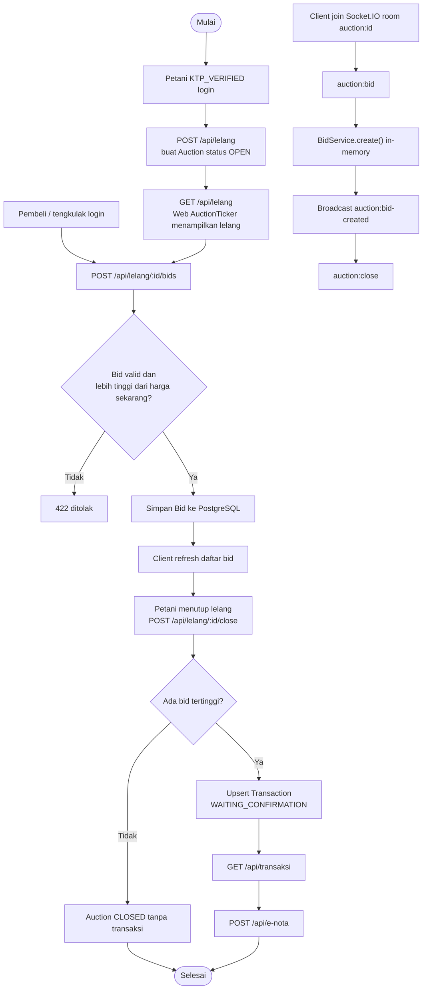
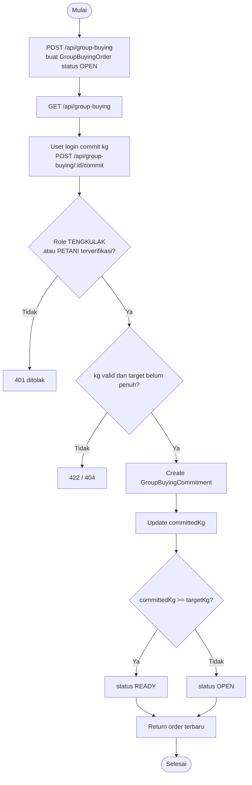
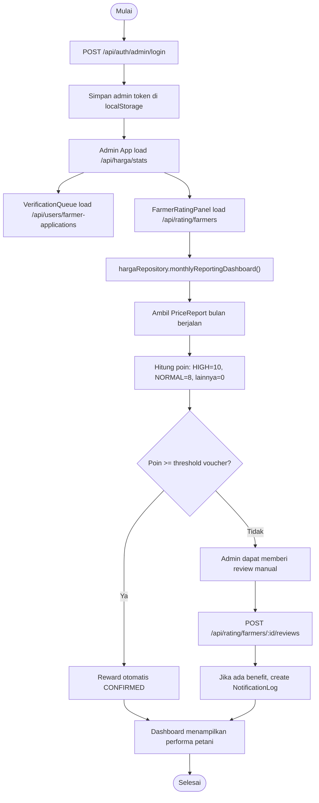

# Class Diagram dan Flowchart

Dokumen ini disusun dari struktur folder dan kode sumber project PanganTerkini. Karena sebagian besar backend memakai pola functional module Express, class diagram berikut memetakan entity database, DTO/shared types, service object, helper, dan client class yang benar-benar ada di folder project.

## Struktur Folder Utama

```text
apps/
  web/                  Next.js PWA untuk pengguna, petani, dan pembeli
  admin/                Vite React dashboard admin
  mobile/               Skeleton Flutter mobile dan offline sync
services/
  api/                  Express API, Prisma, domain routes, auth, harga
  realtime/             Socket.IO gateway lelang
  worker/               BullMQ worker untuk job async
  scraper/              FastAPI scraper Bapanas dan PIHPS
  ml-anomaly/           FastAPI microservice deteksi anomali
packages/
  shared-types/         DTO dan shared contract
  validation/           Zod schema validasi request
  config/               Komoditas, kecamatan, threshold anomali
  ui/                   Helper UI ringan
infra/
  nginx/                Reverse proxy
  prometheus/           Monitoring config
  grafana/              Dashboard placeholder
```

## Class Diagram Domain



## ERD Database

ERD berikut mengikuti model Prisma di `services/api/prisma/schema.prisma`.



Catatan:

- `PRICE_REFERENCE` berdiri sendiri sebagai tabel referensi harga dari PIHPS/Bapanas.
- `NOTIFICATION_LOG` berdiri sendiri sebagai tabel audit broadcast/notifikasi.
- Kolom bertanda `UK` adalah unique key, sedangkan `FK` adalah foreign key.
- Relasi `AUCTION` ke `TRANSACTION` dan `TRANSACTION` ke `RECEIPT` dibuat satu-ke-satu lewat foreign key yang unik di Prisma.

## Class Diagram Layer Aplikasi



## Flowchart Arsitektur Folder dan Service



## Flowchart Verifikasi dan Input Harga Petani



## Flowchart Sinkronisasi Harga Referensi PIHPS



## Flowchart Lelang dan Transaksi



## Flowchart Group Buying



## Flowchart Admin Monitoring dan Reward Petani


